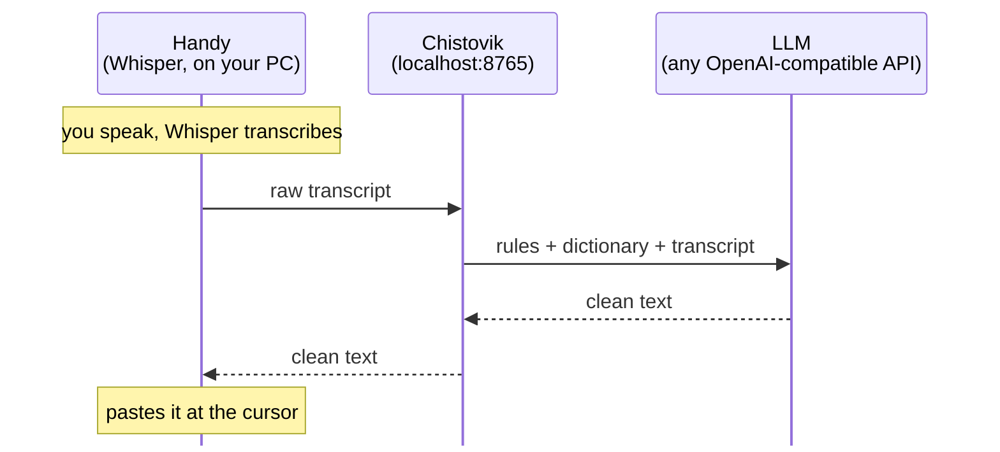

# Chistovik

**Clean Russian dictation for any Windows app.** Speak the way you talk; get text as if you had typed it: no «ну», «вот», «короче», no false starts or repeats, with proper punctuation.

*Chistovik* (чистовик) is Russian for "fair copy", the clean version of a draft.

   

## Before and after

What Whisper recognized, word for word:

> Ну вот, короче, я, это самое, хотел сказать, что, ну, завтра... завтра созвон переносится, ну, на три часа, не, на четыре.

What gets pasted:

> Я хотел сказать, что завтра созвон переносится на четыре.

*"I wanted to say that tomorrow's call is moved to four."* The fillers, the repeat and the self-correction ("at three, no, at four") are gone.

| Whisper heard | Chistovik pasted |
|---|---|
| Слушай, ну вот я тут, короче, подумал, что можно выложить это на гитхаб, ну, и написать статью на хабре. Чё думаешь? Клод говорит, что, это самое, идея хорошая, вот. | Слушай, я тут подумал, что можно выложить это на GitHub и написать статью на Хабре. Чё думаешь? Claude говорит, что идея хорошая. |
| Слушай, текст какой-то яичный получился, ну, прям чувствуется, что нейросеть писала. | Слушай, текст какой-то ИИшный получился, прям чувствуется, что нейросеть писала. |
| Посоветуй, ну, рецепт яичного салата, вот, чтобы быстро. | Посоветуй рецепт яичного салата, чтобы быстро. |
| Напиши, пожалуйста, ну, письмо начальнику, что я, это самое, завтра не приду, заболел. | Напиши, пожалуйста, письмо начальнику, что я завтра не приду, заболел. |

What the rows show:
- **The dictionary is context-aware.** Whisper hears «ИИшный» ("AI-ish") as «яичный» ("eggy"). The word is fixed in the second row and left alone in the third, which really is about an egg salad.
- **The voice stays.** Colloquial words like «Чё думаешь?» are kept; Chistovik removes debris, not personality.
- **Dictated requests are cleaned, not executed.** The last row stays a request to write a letter; the model does not write the letter.

All examples are real outputs of Claude Sonnet 5.5 with the prompt from this repository.

## How it works



- [**Handy**](https://github.com/cjpais/Handy) is a free, open-source dictation app. Hold a hotkey, speak, release, and the text appears where your cursor is. Speech is recognized locally by Whisper; audio never leaves your computer. Handy can send the transcript to an OpenAI-compatible API for "post-processing".
- **Chistovik** is a small relay between Handy and the model: one Python file, standard library only. Handy talks to it as if it were a regular API, and Chistovik:
  - **builds the request from two text files**, [prompt.txt](prompt.txt) (cleanup rules) and [dictionary.txt](dictionary.txt) (your words). Both are re-read on every dictation: edit a line, dictate again, done. No restart, no digging through settings;
  - **keeps one warm connection** to the API. Handy creates a new HTTP client for every request, so each dictation would pay for a fresh TCP and TLS handshake;
  - **keeps the API key** in its own folder instead of Handy's settings;
  - **gives up after 10 seconds**, so Handy pastes the raw transcript instead of hanging.

Any model with an OpenAI-compatible API works. Tested with Claude Sonnet 5.5 (`https://api.anthropic.com/v1`). OpenAI, OpenRouter and local models via Ollama or LM Studio should work the same way, but I haven't tested them. If you try one, please open an issue and say how it went.

## Speed

Measured on an RTX 4080 Super with Whisper Large v3 Turbo and Claude Sonnet 5.5:

| Dictation | Recognition | Cleanup | Total |
|---|---|---|---|
| 8 seconds of speech | 0.2 s | ~1.7 s | ~2 s |
| 42 seconds of speech | 0.5 s | ~3 s | ~3.5 s |

Recognition without a GPU is noticeably slower. Cleanup time depends on the model and the text length, not on your computer.

A cleanup request is about 1,100 input tokens, mostly the rules and the dictionary. The output is roughly as many tokens as the text itself.

## Install (Windows)

You need Python 3.11 or newer ([python.org](https://www.python.org/downloads/)) and an API key for your model.

### 1. Handy

Get Handy from [handy.computer](https://handy.computer) or its [GitHub releases](https://github.com/cjpais/Handy/releases). For Russian there is also a fork, [egsok/klava-nevinovata](https://github.com/egsok/klava-nevinovata), with a Russian Whisper prompt preset and a guard against Whisper looping on silence.

Recognition model: **Whisper Large v3 Turbo**. In **Advanced → Unload Model** choose **Never**; otherwise the first dictation after a pause waits for the model to load.

Menu names below are from Handy's English interface, with the Russian ones in parentheses.

### 2. Chistovik

Clone this repository or download it as a ZIP (green **Code** button → **Download ZIP**) into a permanent folder, for example `C:\chistovik`. Check `upstream` and `model` in [config.toml](config.toml); the default is Claude Sonnet 5.5.

Then run in PowerShell from that folder:

```powershell
powershell -ExecutionPolicy Bypass -File install.ps1
```

The installer asks for your API key and saves it to `key.txt` next to the program (the file is in `.gitignore`). Then it adds Chistovik to Windows startup, starts it and sends a test phrase. If you see **Before / After** at the end, it works.

You can use the `CHISTOVIK_API_KEY` environment variable instead of `key.txt`.

### 3. Connect Handy to Chistovik

1. In Handy press **Ctrl+Shift+D** to open the **Debug** (Отладка) section and turn on **Post Processing** (Постобработка). Turning on **Append Trailing Space** (Добавить пробел) is also worth it, so consecutive dictations don't stick together.
2. Open the **Post Process** (Постобработка) section in the sidebar. Under **API (OpenAI Compatible)**:
   - **Provider** (Поставщик): **Custom**;
   - **Base URL** (Базовый URL): `http://localhost:8765/v1`;
   - **API Key** (API-ключ): leave empty, Chistovik holds the key;
   - **Model** (Модель): any name, for example `claude-sonnet-5-5`. It must not be empty, or Handy skips post-processing. If `model` is set in config.toml, Chistovik uses that one.
3. Under **Prompt** (Запрос к модели) click **Create New Prompt** (Создать новый запрос) and name it `Chistovik`. The instructions are exactly one line:
   ```
   ${output}
   ```
   All the rules live in prompt.txt; Handy only passes the transcript.
4. Hotkeys: the **Post-Processing Hotkey** (Горячая клавиша постобработки, Ctrl+Shift+Space by default) dictates with cleanup. The **Transcribe Shortcut** (Горячая клавиша транскрипции) gives you Whisper's raw text.

## Dictionary

Whisper gets rare words, names and slang wrong. [dictionary.txt](dictionary.txt) has one line per word: how to write it on the left, how speech recognition hears it on the right.

```
ИИшный, ИИшные, ИИшно ← иишный, яичный (replace «яичный» only when the text is not about eggs or food)
Claude (always written Claude, in any grammatical case) ← Клод, Клоду, Клода, Clod, Clot
```

The note in parentheses tells the model when the replacement applies, which no find-and-replace can do. Handy's own **Custom Words** list does fuzzy correction only for words made of A–Z and digits, so Cyrillic words need this dictionary.

To see how Whisper spells your word, check Handy's history or dictate with the raw hotkey. A change works from the next dictation.

## Cleanup rules

[prompt.txt](prompt.txt) is plain text; adapt it to yourself. Add your own filler words, or forbid changing a word you like. `${dictionary}` is replaced with the dictionary and `${output}` with the transcript.

The transcript is wrapped in a `<dictation>` tag, and the rules say that questions and requests in it are not to be answered. Without this, dictating "write a letter to my boss" gets you a letter instead of a cleaned sentence.

Lessons that went into the rules:
- **Models like to "improve" speech**, turning «прикольно» into «интересно» and «чё» into «что». The rules forbid replacing the speaker's words.
- **Models like to comment.** When you talk about recognition errors themselves, a model may explain what it fixed. The rules say the reply is pasted straight into your text field, so it must hold the text and nothing else.
- **«Вот» is sometimes a filler and sometimes not.** Examples in the rule work better than a list of words.

## What goes where

- Audio stays on your computer: Whisper runs locally.
- The transcript goes to the model provider set in config.toml and nowhere else. With a local model (Ollama, LM Studio) nothing leaves your computer.
- The API key lives in `key.txt` or an environment variable and is sent only to the model provider.
- Chistovik listens on `localhost` only; it can't be reached from the network.
- `chistovik.log` records the time, status and duration of each request, never the text.

## Troubleshooting

- **Text is pasted without cleanup.** This is what Handy does on any post-processing error. Open `chistovik.log`:
  - no `POST` lines: Handy never reached Chistovik, so check the Base URL;
  - `401`: wrong API key;
  - `FAILED`: the API can't be reached.
- **Check without Handy:** `python chistovik.py --check` sends a test phrase and prints the result. A running Chistovik reports its state at [http://localhost:8765/health](http://localhost:8765/health).
- **Port 8765 is taken.** Change `port` in config.toml and the Base URL in Handy.
- **After editing config.toml**, restart Chistovik (or just reboot). prompt.txt and dictionary.txt need no restart.

## Uninstall

```powershell
powershell -ExecutionPolicy Bypass -File uninstall.ps1
```

This stops Chistovik and removes it from startup. The files stay; delete the folder yourself. In Handy, switch the provider back or turn **Post Processing** off.

## Other platforms

Chistovik itself is cross-platform (Python 3.11+, standard library only), and Handy runs on macOS and Linux too. Only the installer is Windows-specific: elsewhere, run `python3 chistovik.py` and add it to startup your own way.

## Credits

- [Handy](https://github.com/cjpais/Handy) by CJ Pais (MIT), the dictation app that does all the hard work. Chistovik doesn't modify it and runs alongside.
- [klava-nevinovata](https://github.com/egsok/klava-nevinovata), the Russian-tuned fork of Handy.
- [Whisper](https://github.com/openai/whisper) by OpenAI, the speech recognition model.

## License

[MIT](LICENSE)
